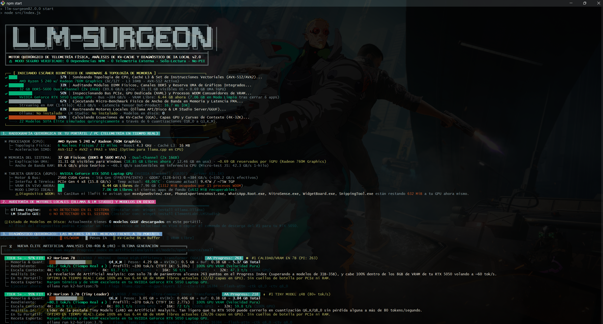
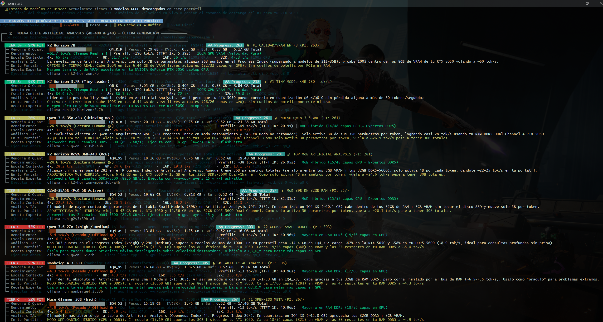
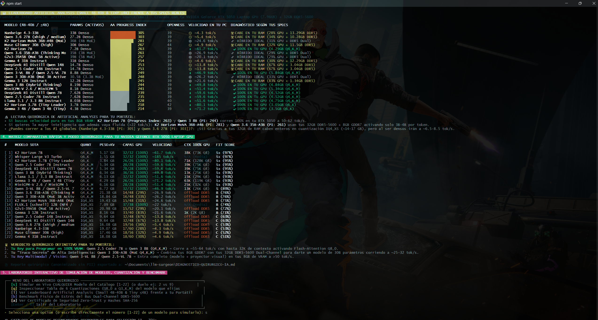
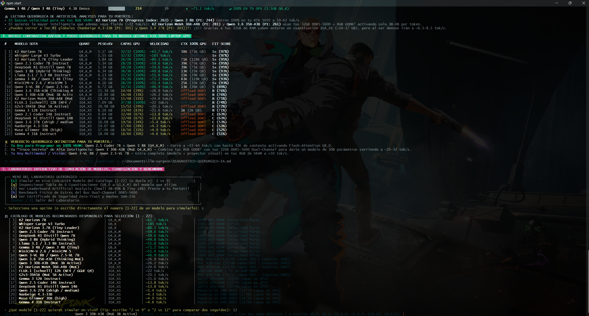

# [LLM-SURGEON v2.0] // Surgical Local AI Hardware Diagnostic & Inference Physics CLI

[](https://github.com/Leonel59/LLM-SURGEON/actions)
-brightgreen)
-blue)

-orange)


> **LANGUAGE NAVIGATION // NAVEGACION DE IDIOMA:**
> **[ [ENGLISH DOCUMENTATION](#english-documentation) ]** `::` **[ [DOCUMENTACION EN ESPANOL](#documentacion-en-espanol) ]** `::` **[ [STANDALONE ESPANOL (README.es.md)](./README.es.md) ]**

```text
  ╔════════════════════════════════════════════════════════════════════════════════════════════════════════╗
  ║   ██╗     ██╗     ███╗   ███╗      ███████╗██╗   ██╗██████╗  ██████╗ ███████╗ ██████╗ ███╗   ██╗       ║
  ║   ██║     ██║     ████╗ ████║      ██╔════╝██║   ██║██╔══██╗██╔════╝ ██╔════╝██╔═══██╗████╗  ██║       ║
  ║   ██║     ██║     ██╔████╔██║█████╗███████╗██║   ██║██████╔╝██║  ███╗█████╗  ██║   ██║██╔██╗ ██║       ║
  ║   ██║     ██║     ██║╚██╔╝██║╚════╝╚════██║██║   ██║██╔══██╗██║   ██║██╔══╝  ██║   ██║██║╚██╗██║       ║
  ║   ███████╗███████╗██║ ╚═╝ ██║      ███████║╚██████╔╝██║  ██║╚██████╔╝███████╗╚██████╔╝██║ ╚████║       ║
  ║   ╚══════╝╚══════╝╚═╝     ╚═╝      ╚══════╝ ╚═════╝ ╚═╝  ╚═╝ ╚═════╝ ╚══════╝ ╚═════╝ ╚═╝  ╚═══╝       ║
  ╠════════════════════════════════════════════════════════════════════════════════════════════════════════╣
  ║ SURGICAL HARDWARE TELEMETRY, GQA KV-CACHE PHYSICS & REAL-TIME LOCAL AI DIAGNOSTIC ENGINE v2.0          ║
  ║ Inspired by CanIRun.ai + ArtificialAnalysis.ai + llmfit.org (Curated by sections, zero model bloat)    ║
  ║ [ SECURE ZERO-TRUST ] 0 NPM Dependencies :: 0 External Telemetry :: 100% Read-Only :: Auto PII-Redact  ║
  ╚════════════════════════════════════════════════════════════════════════════════════════════════════════╝
```

---

<a name="english-documentation"></a>

# [PART I] ENGLISH DOCUMENTATION

**`LLM-Surgeon`** is a zero-dependency terminal diagnostic engine, **Grouped-Query Attention (GQA) KV-Cache** physics simulator, and real-time token cadence benchmark. It inspects your physical hardware at the register/driver level (`NVML`, `SMBIOS/CIM`, `sysctl`, `WDDM`) to tell you with surgical accuracy **which state-of-the-art (SOTA) local AI models run best on your exact laptop or desktop**.

---

## [01] Origin & Inspiration: Why LLM-Surgeon Exists

`LLM-Surgeon` was engineered by taking the strongest concepts from three major references in the local AI ecosystem and solving the technical blind spots of each:

1. **Inspired by [CanIRun.ai](https://canirun.ai/):** We adopted its clean **section-based curation** (*Coding, Reasoning, General, Vision, Media*). However, because *CanIRun.ai* runs inside a web browser sandbox, it cannot see your real free VRAM, background OS/WDDM processes eating GPU memory, iGPU UMA RAM reservations, or dual-channel memory topology.
2. **Inspired by [llmfit](https://www.llmfit.org/):** We adopted native **terminal hardware probing**. However, *llmfit* dumps an overwhelming list of nearly 500 uncurated models into the console, making it hard to find the actual SOTA leaders. `LLM-Surgeon` replaces that raw list with **6 structured, high-signal SOTA sections**, adds **4K-to-32K context degradation curves**, and introduces an **interactive real-time token simulator**.
3. **Powered by [Artificial Analysis](https://artificialanalysis.ai/models/open-source) Multi-Scale Benchmarks:** We integrated the latest **Artificial Analysis Progress Index v1** and **Openness Index** metrics across **all 4 parameter scales**:
   - **Tiny Models (`<=4B`):** `K2 Horizon 3.7B`, `Gemma 3 4B / Qwen 3 4B`
   - **Small Models (`4B-40B`):** `Nanbeige 4.3-33B`, `Qwen 3.6 27B`, `K2 Horizon MoVA 36B-A4B`, `Muse Glimmer 30B`, `K2 Horizon 7B`, `Qwen 3.6 35B-A3B`, `G2v3-39A5B`, `Gemma 4 31B`
   - **Medium Models (`40B-150B`):** `Llama 3.3 70B`, `Llama 4 Scout 109B-A17B MoE`, `MiMo-V2.6-Pro`
   - **Large Models (`>150B` Frontier):** `Kimi K3.1 Pro (#1 Global)`, `DeepSeek V4.1 Flash 1017 (#2 Global)`, `GLM-5.3 (max) (#3 Global)`
   cross-referencing their benchmark intelligence against your machine's exact VRAM + System RAM budget.

| Capability / Feature | CanIRun.ai (Web) | llmfit (CLI) | Artificial Analysis (Web) | **LLM-Surgeon v2.0 (CLI)** |
| :--- | :---: | :---: | :---: | :---: |
| **Curated SOTA Sections (No 500-model dump)** | `[YES]` | `[NO]` | `[YES]` | **`[YES // 7 SECTIONS]`** |
| **Live Free VRAM vs WDDM Parasitic App Detection** | `[NO]` | `[PARTIAL]` | `[NO]` | **`[YES // LIVE vs CLEAN]`** |
| **SMBIOS Dual-Channel + iGPU UMA RAM Analysis** | `[NO]` | `[NO]` | `[NO]` | **`[YES // EXACT GB/s]`** |
| **GQA KV-Cache Math & 4K->32K Context Curve** | `[NO]` | `[PARTIAL]` | `[NO]` | **`[YES // FP16 vs Q8_0]`** |
| **Artificial Analysis (`Tiny` / `Small` / `Medium` / `Large`)** | `[NO]` | `[NO]` | `[YES]` | **`[YES // MAPPED TO PC]`** |
| **Interactive Live Token Cadence Simulator (`ms/tok`)** | `[NO]` | `[NO]` | `[NO]` | **`[YES // 28 MODELS + DUELS]`** |
| **Live Speed Benchmark on Local Ollama / LM Studio** | `[NO]` | `[NO]` | `[NO]` | **`[YES // TTFT + VRAM PEAK]`** |
| **Zero NPM Dependencies & Zero Outbound Network** | `[N/A]` | `[YES]` | `[N/A]` | **`[YES // SHA-256 VERIFIED]`** |

---

## [02] Real Terminal Screenshots

### A // ASCII Biometric Scanner & Real-Time Hardware Radiography (NVML + WDDM + UMA)


### B // Section-Based SOTA Diagnostic Cards (Segmented VRAM Bar, 4K-32K Curve & Exact Flags)


### C // Official Artificial Analysis Leaderboard (`Small 4B-40B` & `Tiny <=4B`) vs Your Hardware


### D // Interactive Laboratory: Real-Time Model Simulation, Duels (`1 vs 13`) & Quantization Inspector


---

## [03] Step-by-Step Installation & Usage (Windows, Linux & macOS)

### Prerequisites
- **Node.js `>= 18.0.0`** (v20 or v22 LTS recommended). Verify with `node --version`.
- **NVIDIA Drivers** (optional, if you have an NVIDIA GPU, so `nvidia-smi` is available in `PATH`). Works automatically on AMD/Intel iGPUs and Apple Silicon Unified Memory as well.

---

### [WINDOWS] Step-by-Step (PowerShell, Git Bash, CMD / Windows Terminal)

```powershell
# 1. Clone the repository
git clone https://github.com/Leonel59/LLM-SURGEON.git
cd LLM-SURGEON

# 2. (Optional but Recommended) Run the 73ms Zero-Trust Security Audit before running
npm test

# 3. Register the global 'llm-surgeon' command in your terminal
npm link

# 4. Run from ANY folder in PowerShell, Git Bash, or CMD!
llm-surgeon
```
*Note for **Git Bash (`MINGW64`)** users:* Always use forward slashes when navigating directories (e.g. `cd ~/Documents/LLM-SURGEON`), or simply type `llm-surgeon` from anywhere after running `npm link`. You can also double-click [`diagnosticar-ia.bat`](./diagnosticar-ia.bat) from Windows Explorer.

---

### [LINUX] Step-by-Step (Ubuntu, Debian, Fedora, Arch)

```bash
# 1. Clone the repository
git clone https://github.com/Leonel59/LLM-SURGEON.git
cd LLM-SURGEON

# 2. Verify security & zero-dependency integrity
npm test

# 3. Link the binary globally (or run directly with 'node src/index.js')
npm link

# 4. Launch from anywhere
llm-surgeon
```

---

### [macOS] Step-by-Step (Apple Silicon M1/M2/M3/M4 & Intel)

```bash
# 1. Clone the repository
git clone https://github.com/Leonel59/LLM-SURGEON.git
cd LLM-SURGEON

# 2. Verify security suite
npm test

# 3. Link globally and launch
npm link
llm-surgeon
```

---

### [ZERO-INSTALL] Run Directly via `npx`
If you want to run `LLM-Surgeon` immediately without cloning:
```bash
npx github:Leonel59/LLM-SURGEON
```

---

## [04] Global CLI Flags & Interactive Laboratory Commands

| Command | Description |
| :--- | :--- |
| `llm-surgeon` | Runs the animated 6-stage ASCII scanner + Full Diagnostic + Interactive Lab |
| `llm-surgeon --help` | Displays the quick command reference |
| `llm-surgeon --fast` | Skips the boot animation and prints the full diagnostic report instantly |
| `llm-surgeon --simulate=1vs13` | Runs a head-to-head real-time token streaming duel (`Model #1` vs `Model #13`) |
| `llm-surgeon --inspect=k2-horizon-7b` | Displays the deep-dive table of all 6 quantizations (`Q8_0` down to `Q3_K_M`) |
| `llm-surgeon --security-audit` | Prints the Zero-Trust Security Certificate and live **SHA-256** source hashes |
| `llm-surgeon --offline` | Strictly disables even local `127.0.0.1` checks for Ollama / LM Studio |
| `llm-surgeon --export` | Exports `DIAGNOSTICO-QUIRURGICO-IA.md` (PII-redacted) into the current directory |

### Inside the Interactive Laboratory (`[06]`)
Once the scan completes, the terminal stays open in an interactive laboratory loop:
- **Type `[1]` to `[22]` (or press `[s]`):** Simulate **any** of the 22 SOTA models in real time at the exact `ms/token` decode cadence and `TTFT` prefill latency calculated for your hardware. You can also test a specific quantization (`Q8_0`, `Q6_K`, `Q5_K_M`, `Q4_K_M`, `IQ4_XS`, `Q3_K_M`) or simulate with your current background apps open (`live`).
- **Type `1 vs 13` (Duel Mode):** Watch two models stream side-by-side sequentially (e.g., a 100% GPU `7B` model at `~61.7 tok/s` vs a `36B-A4B MoE` hybrid model at `~24.6 tok/s`, or a `33B Dense` model offloading to DDR5 at `~4.3 tok/s`).
- **Press `[q]`:** Inspect the 6 quantization profiles for any chosen model.
- **Press `[l]`:** Display the **Artificial Analysis (`Small 4B-40B` & `Tiny <=4B`) Leaderboard** matched to your specs.
- **Press `[r]`:** (Appears automatically when **Ollama** or **LM Studio** models are detected on your disk/API) Sends a real coding prompt to your downloaded model and measures physical **TTFT (ms)**, **Prefill (tok/s)**, **Decode (tok/s)**, and **Peak VRAM delta (MiB)**.

---

## [05] Zero-Trust Security Architecture (Why You Can Trust This CLI)

Running a hardware diagnostic tool in your terminal requires **verifiable cryptographic and static guarantees**:

1. **`[0 NPM DEPENDENCIES]` Supply-Chain Immune:** Inspect [`package.json`](./package.json). There are **zero** `dependencies` and **zero** `devDependencies`. It uses 100% built-in Node.js modules (`node:os`, `node:child_process`, `node:crypto`, `node:fs`, `node:test`).
2. **`[ZERO OUTBOUND NETWORK]` Loopback Firewall:** In [`src/security/security-guard.js`](./src/security/security-guard.js), `assertLoopbackUrl()` programmatically blocks any address other than `http://127.0.0.1:11434` (local Ollama) and `http://127.0.0.1:1234` (local LM Studio).
3. **`[CWE-78 IMMUNE]` No Shell Execution:** `execSync`, `eval()`, and `shell: true` are strictly banned and enforced by static unit tests. All hardware queries use `execFileSync` with isolated argument arrays and a strict binary allowlist.
4. **`[NO-PII PRIVACY]` Automatic Path Redaction:** Hardware serial numbers, MAC addresses, and hostnames are never read. OS user paths (`C:\Users\YourName\...` or `/home/yourname/...`) are automatically redacted to `~/...` so you can safely share terminal screenshots anywhere.

Verify all 7 security and style assertions yourself in `< 100ms`:
```bash
npm test
npm run security:audit
```

---
---

<a name="documentacion-en-espanol"></a>

# [PARTE II] DOCUMENTACION EN ESPANOL

**`LLM-Surgeon`** es un motor quirurgico de diagnostico fisico de hardware en terminal, simulador matematico de **KV-Cache (GQA) / Partial Offloading** y banco de pruebas de velocidad en tiempo real. Analiza tu hardware real (`NVML`, `SMBIOS/CIM`, `WDDM`) para indicarte con precision de laboratorio **que modelos de IA locales corren mejor en tu portatil o PC**.

---

## [01] Origen e Inspiracion: Por que creamos LLM-Surgeon

`LLM-Surgeon` nacio combinando lo mejor de tres grandes herramientas del ecosistema de IA local y superando las limitaciones de cada una:

1. **Basado en la curaduria de [CanIRun.ai](https://canirun.ai/):** Adoptamos su enfoque de mostrar los mejores modelos **organizados por secciones practicas** en vez de listas caoticas. Sin embargo, como *CanIRun.ai* vive en el navegador web, no puede detectar cuanta VRAM real te queda libre, que aplicaciones de Windows (WDDM) te estan robando memoria grafica en segundo plano, ni la reserva UMA de tu grafica integrada.
2. **Mejorando el enfoque en terminal de [llmfit](https://www.llmfit.org/):** Adoptamos la lectura directa desde consola, pero resolvimos el gran defecto de *llmfit*: escupir una lista gigante de casi 500 modelos donde uno pierde tiempo buscando. `LLM-Surgeon` filtra el ruido en **6 secciones SOTA de alto impacto**, calcula curvas de contexto de `4K a 32K` y anade un **simulador interactivo en vivo**.
3. **Potenciado con metricas Multi-Escala de [Artificial Analysis](https://artificialanalysis.ai/models/open-source):** Incorporamos los modelos mas nuevos y sus puntajes oficiales (*Progress Index v1* y *Openness Index*) a traves de **las 4 escalas de parametros**:
   - **Tiny Models (`<=4B`):** `K2 Horizon 3.7B`, `Gemma 3 4B / Qwen 3 4B`
   - **Small Models (`4B-40B`):** `Nanbeige 4.3-33B`, `Qwen 3.6 27B`, `K2 Horizon MoVA 36B-A4B`, `Muse Glimmer 30B`, `K2 Horizon 7B`, `Qwen 3.6 35B-A3B`, `G2v3-39A5B`, `Gemma 4 31B`
   - **Medium Models (`40B-150B`):** `Llama 3.3 70B`, `Llama 4 Scout 109B-A17B MoE`, `MiMo-V2.6-Pro`
   - **Large Models (`>150B` Frontier):** `Kimi K3.1 Pro (#1 Global)`, `DeepSeek V4.1 Flash 1017 (#2 Global)`, `GLM-5.3 (max) (#3 Global)`
   diagnosticando automaticamente cuales corren en tu portatil (8GB-32GB) y cuales requieren Workstations o Clusters (64GB-192GB+).

---

## [02] Guia Paso a Paso de Instalacion (Windows, Linux y macOS)

### Requisitos Previos
- **Node.js `>= 18.0.0`** (recomendado v20 o v22 LTS). Comprueba tu version con `node --version`.

### 1. En Windows (PowerShell, Git Bash, CMD / Windows Terminal)

```bash
# Paso 1: Clonar el repositorio
git clone https://github.com/Leonel59/LLM-SURGEON.git
cd LLM-SURGEON

# Paso 2: (Opcional) Verificar los 7 tests de seguridad Zero-Trust en 70ms
npm test

# Paso 3: Registrar el comando global 'llm-surgeon' en tu sistema
npm link

# Paso 4: Ejecutalo desde CUALQUIER carpeta escribiendo solo:
llm-surgeon
```
*(Nota para usuarios de **Git Bash**: recuerda usar barras normales `/` al usar `cd`, o simplemente escribe `llm-surgeon` desde cualquier ruta tras hacer `npm link`. Tambien puedes abrir [`diagnosticar-ia.bat`](./diagnosticar-ia.bat) con doble clic).*

### 2. En Linux y macOS (Apple Silicon M1/M2/M3/M4 e Intel)

```bash
git clone https://github.com/Leonel59/LLM-SURGEON.git
cd LLM-SURGEON
npm test
npm link
llm-surgeon
```

### 3. Ejecucion Instantanea sin Clonar (`npx`)
```bash
npx github:Leonel59/LLM-SURGEON
```

---

## [03] Que Analiza Quirurgicamente en tu PC / Portatil

1. **Radiografia Real de Hardware (`[01]`):**
   - Detecta CPU, nucleos fisicos/logicos, cache L3 e instrucciones vectoriales (`AVX-512`, `AVX2`, `ARM NEON`).
   - Lee los modulos fisicos de RAM (`Dual-Channel DDR5/DDR4`), explica cuanta memoria reserva la grafica integrada (**UMA Framebuffer**) y ejecuta un micro-benchmark en memoria en vivo.
   - Consulta `nvidia-smi` para medir **VRAM Total vs VRAM Libre en Vivo**, identifica **procesos vampiro WDDM** (`WhatsApp`, `EdgeWebView2`, `NVIDIA Overlay`, etc.) y compara tu rendimiento en **Estado Actual** vs **Modo Quirurgico Limpio**.
2. **Auditoria de Ollama y LM Studio (`[02]`):**
   - Detecta binarios instalados, manifiestos y modelos `.gguf` en disco, y servidores locales en `127.0.0.1:11434` y `127.0.0.1:1234`.
3. **Diagnostico por Secciones SOTA (`[03]`) y Leaderboard Artificial Analysis (`[04]`):**
   - Calcula para cada modelo el **Quant Ideal** (`Q8_0` a `Q3_K_M`), peso exacto de **KV-Cache (GQA)**, reparto de capas entre GPU y RAM (`n_gpu_layers`), velocidad de **Prefill (`TTFT`)** y **Decode (`tok/s`)**, y la curva de degradacion desde `4K` hasta `32K` de contexto.
4. **Laboratorio Interactivo en Consola (`[06]`):**
   - Simula en tiempo real cualquiera de los **22 modelos recomendados** (`[1]` al `[22]`), permite hacer **duelos comparativos** (ej. `1 vs 13` o `4 vs 17`), inspeccionar las 6 cuantizaciones de cualquier modelo (`[q]`), o lanzar un benchmark real contra tus modelos descargados en Ollama/LM Studio (`[r]`).

---

## [04] Licencia y Seguridad

Distribuido bajo licencia **MIT**. Revisa [`SECURITY.md`](./SECURITY.md) para los detalles completos de la arquitectura Zero-Trust.
